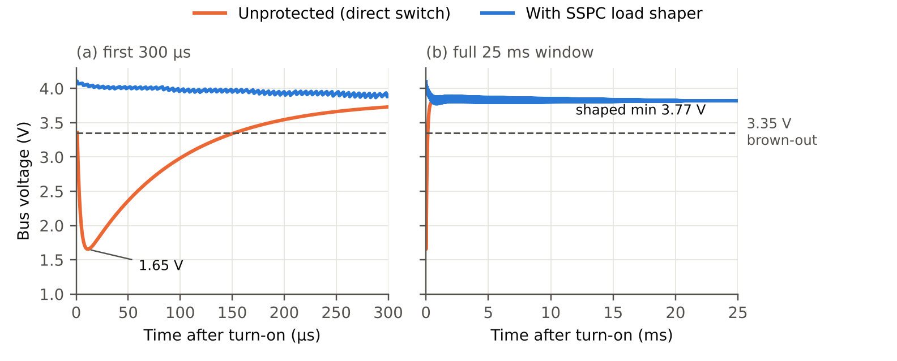

# SSPC Load Shaper — RTL Design + SystemVerilog Verification

A **sink-side Solid-State Power Controller (SSPC) load shaper** for a CubeSat
Electrical Power System, written in Verilog, with a class-based SystemVerilog
verification environment and a Perl triage script.

The SSPC sits in series with one payload. On every commanded turn-on it chops
the payload's MOSFET with a PWM duty cycle that ramps from 0.8 % to 100 %, so the
payload's empty input capacitor charges gradually and its inrush current cannot
brown out the shared bus. While the payload runs, the SSPC watches the bus through
an ADC, re-shapes on a fast drop, and sheds the load with a latched fault flag if
the bus falls below 3.35 V.

## Results (functional simulation)

220 µF / 4 Ω payload on a 4.1 V single-cell bus (R_PACK = 0.3 Ω, C_BUS = 47 µF):

| Metric | Unprotected | With SSPC |
|---|---|---|
| Minimum bus voltage | 1.654 V | **3.774 V** |
| Sag depth (4.1 V − min) | 2.446 V | 0.326 V (**−86.7 %**) |
| Time below 3.35 V brown-out line | ≈150 µs | 0 |
| Peak battery current (1 µs avg) | 8.15 A | 1.05 A |
| Outcome | brown-out | MONITOR at 20.73 ms, no fault |



Sweeps over payload capacitance (47–4700 µF) and load (1.2–10 Ω) show:

- Across the rated range (47–1000 µF, 2–10 Ω) the shaped bus stays above 3.47 V;
  every unprotected turn-on browns out (1.22–2.56 V).
- **Capacitive limit:** at the default ramp (RAMP_W = 12) the shaper passes at
  1500 µF and faults at 2200 µF; the limit falls with heavier loads (fault at
  1768 µF / 1.78 Ω). Larger payloads need a slower ramp.
- **Overload:** loads above ≈2.5 A pull the steady bus below 3.35 V; the SSPC
  correctly sheds them.
- **Known design hole:** if the steady bus lands between 3.35 V and 3.45 V
  (R_L ≈ 1.24–1.50 Ω) the FSM never leaves SHAPE. Fix: a watchdog in SHAPE.

## Constrained-random regression (Vivado xsim 2022.2)

| Run | Shaped PASS / FAIL | Baseline brown-outs | Coverage | triage.pl exit |
|---|---|---|---|---|
| Rated, N = 20 | 11 / 0 | 9 of 9 | 79.8 % | 0 |
| +STRESS, N = 40 | 9 / 11 | 20 of 20 | 84.5 % | 1 |

Stress failures: 10 capacitive-limit faults (C_PL 1768–4617 µF) and 1
hysteresis-band hang (1151 µF / 1.34 Ω). An overload case (1.06 Ω) faulted and
was correctly scored PASS.

## Synthesis (Vivado 2022.2, xc7a100tcsg324-1, 50 MHz)

65 LUTs · 46 FFs · 20 I/O · 1 BUFG · setup WNS +15.98 ns · hold WHS +0.22 ns · register-to-register Fmax ≈ 249 MHz (I/O paths unconstrained).

## Repository layout

```
RTL/
  sspc_load_shaper.v   # DUT: 4-state FSM + PWM soft-start
  tb_sspc.v            # directed testbench, bus + payload plant, CSV dump
Verification/
  sspc_if.sv           # interface + clocking block
  sspc_txn.sv          # randomized scenario (C_PL, R_L, shaper) + sspc_result
  sspc_coverage.sv     # covergroup: 5 coverpoints, 2 crosses
  sspc_driver.sv       # drives DUT, runs plant one step per clock
  sspc_scoreboard.sv   # reference model (steady-state bus) + PASS/FAIL
  tb_top.sv            # top + constrained-random generator
Automation/
  triage.pl            # parses xsim log, reports, exits 1 on failure
waveform.png
```

## The plant model

Integrated every 20 ns clock. The payload starts with an empty input capacitor.

```
i_src = (V_OC - v_bus) / R_PACK
i_sw  = sw_on ? (v_bus - v_pl) / R_SW : 0
v_bus += (i_src - i_sw) * dt / C_BUS
v_pl  += (i_sw - v_pl / R_L) * dt / C_PL
```

Steady state, used by the scoreboard as its reference model:
`V_bus,ss = V_OC (R_SW + R_L) / (R_PACK + R_SW + R_L)`.

## Reproducing

Vivado 2022.2 (xsim) or Icarus Verilog 12 for the directed testbench (both give identical results); xsim for the
SystemVerilog environment; Perl 5 for triage.

```bash
# directed testbench (nominal turn-on)
xvlog RTL/sspc_load_shaper.v RTL/tb_sspc.v
xelab tb_sspc -s sspc_sim -debug typical
xsim sspc_sim -runall
#   options: -testplusarg "CPL=470e-6" -testplusarg "RL=2.0" -testplusarg "CSV=1"  (quote on Windows)

# constrained-random regression
xvlog RTL/sspc_load_shaper.v
xvlog -sv Verification/sspc_if.sv Verification/sspc_txn.sv Verification/sspc_coverage.sv \
          Verification/sspc_driver.sv Verification/sspc_scoreboard.sv Verification/tb_top.sv
xelab tb_top -s sv_sim -debug typical
xsim sv_sim -runall -testplusarg "N_TXN=20" > sim_output.log
xsim sv_sim -runall -testplusarg "N_TXN=40" -testplusarg STRESS > sim_stress.log
perl Automation/triage.pl sim_output.log
```

Icarus: `iverilog -g2012 -o sim RTL/sspc_load_shaper.v RTL/tb_sspc.v && vvp sim`

## Correction to earlier results

An earlier version of this repository reported a ~40 % sag reduction
(3.05 V → 3.48 V) and a "2.5 A operating limit". Both were testbench artefacts.
The old plant modelled the payload as a constant 3.5 A load with no input
capacitance, so 3.05 V was just the DC drop 4.1 − 3.5 × 0.3, and the shaped value
was read 250 µs into a 425 µs ramp. With a longer window the shaped case also
faulted. The 2.5 A "limit" was (4.1 − 3.35)/0.3 from Ohm's law. The current plant
models the payload's input capacitor, which is what causes inrush, and the ramp
was retuned against it.

## Scope and honesty

- Functional simulation against a lumped behavioural plant. Not SPICE, not
  hardware, not run on an FPGA board.
- PWM limits the *average* current. Each early pulse into the empty capacitor
  still reaches ~41 A, limited only by R_SW; a real switch needs a matching
  pulse rating or a current limit.
- The ramp is open-loop. The bus voltage only drives state transitions.
- ADC assumed synchronous to `clk`; no synchronizer yet.
- Class-based SystemVerilog, **not** the UVM library.
- Per-load protection, not bus-wide management; never placed on the OBC.

## Next steps

Watchdog in SHAPE · closed-loop ramp · ADC synchronizer + ripple filter ·
pulse-current limit · LTspice cross-check of the plant · UVM port · TMR on the
state register · FPGA board test.
